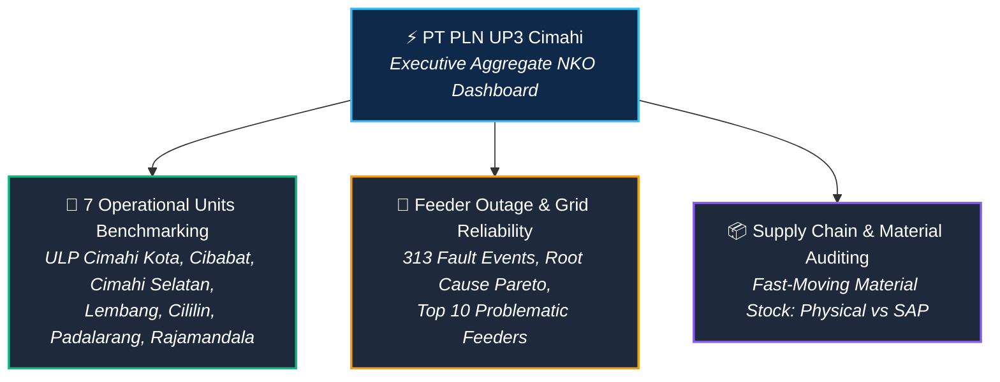

# ⚡ PT PLN (Persero) UP3 Cimahi — Enterprise Operations, Feeder Reliability & NKO Performance BI Suite

[](https://lookerstudio.google.com/)
[](https://developers.google.com/sheets)
[](https://pln.co.id)
[](https://pln.co.id)
[](https://github.com/)

An end-to-end multi-tier Executive Operations & Business Intelligence system engineered for **PT PLN (Persero) UP3 Cimahi**, integrating annual organizational health indicators (**Nilai Kinerja Organisasi / NKO**), grid distribution reliability (**SAIDI / SAIFI / ENS**), root-cause feeder outage telemetry, and supply chain inventory auditing across **7 Customer Service Units (ULP)**.

---

## 📌 Executive Summary & Architecture Hierarchy

As one of the critical electricity distribution hubs in West Java, **PT PLN (Persero) UP3 Cimahi** oversees power distribution across municipal and mountainous suburban topographies (encompassing Cimahi City and West Bandung Regency). 

This Business Intelligence suite was architected to solve operational reporting silos by providing a 4-tier decision support system:



> 📑 **[Unduh Dokumen Laporan Lengkap 14 Halaman Dasbor (PDF)](assets/pln_nko_complete_dashboard_report_2025.pdf)**  
> 🔗 **[Buka Dasbor Interaktif di Google Looker Studio](https://datastudio.google.com/reporting/744c4bea-9c47-44fc-a30f-f2afec72ebde/page/AFOVF)**

---

## 📊 Tier 1: Executive NKO Aggregate (UP3 Cimahi)

The executive command dashboard tracks overall organizational health against a baseline target of **1,305.72 points**, recording an actual achievement of **1,172.20 points** with a performance variance of **-133.52 Loss Points**:

```text
+---------------------------------------------------------------------------------+
|                       STATUS KINERJA ORGANISASI (TRAFFIC LIGHT)                |
+--------------------------+-----------------------------+------------------------+
| 🟢 Kinerja Hijau: 396    | 🟡 Kinerja Kuning: 23       | 🔴 Kinerja Merah: 85   |
| (Target Tercapai)        | (Perlu Perhatian)           | (Defisit Kritis)       |
+--------------------------+-----------------------------+------------------------+
```

### Breakdown Capaian per Bidang Fungsional:
* **PEL (Pelayanan Pelanggan & Niaga):** `90.94%` (451 / 496.2 Poin)
* **JAR (Jaringan Distribusi & Keandalan):** `82.16%` (333 / 405.6 Poin) $\rightarrow$ *Kontributor defisit terbesar!*
* **TEL (Transaksi Energi Listrik):** `97.50%` (191 / 195.6 Poin)
* **REN (Perencanaan):** `95.59%` (111 / 115.9 Poin)
* **KU (Keuangan & Umum):** `92.83%` (74 / 79.2 Poin)
* **KONS (Konstruksi):** `96.21%` (13 / 13.2 Poin)

---

## 🏢 Tier 2: 7-ULP Operational Benchmarking Matrix

A comparative operational diagnostic evaluating all 7 sub-units under UP3 Cimahi, highlighting top performers and units requiring urgent grid reinforcement:

| Peringkat | Unit Layanan Pelanggan (ULP) | Target Poin | Realisasi Poin | Variance (Loss Point) | 🟢 Hijau | 🟡 Kuning | 🔴 Merah | Analisis Diagnostik |
| :---: | :--- | :---: | :---: | :---: | :---: | :---: | :---: | :--- |
| **1** | **ULP Cibabat** | 1,308.00 | **1,235.83** | **-72.17** | 240 | 5 | 31 | 🏆 **Performa Terbaik:** Keandalan SAIDI (489.48 menit) & SAIFI (7.96 kali) jauh di atas target. |
| **2** | **ULP Cimahi Kota** | 1,310.40 | **1,235.37** | **-75.03** | 305 | 16 | 39 | Efisiensi susut jaringan sangat rendah (17.13%), response time cepat (280 menit). |
| **3** | **ULP Cimahi Selatan** | 1,310.40 | **1,230.29** | **-80.11** | 309 | 5 | 46 | Penjualan energi prima (2.155 GWh), kendala pada gangguan penyulang > 5 menit (-22.44 pt). |
| **4** | **ULP Lembang** | 1,310.40 | **1,215.30** | **-95.10** | 303 | 9 | 48 | Area wisata dataran tinggi; keandalan SAIFI (6.98 kali) terkendali meski cuaca ekstrem. |
| **5** | **ULP Cililin** | 1,310.40 | **1,161.63** | **-148.77** | 286 | 5 | 69 | Area rural/pedesaan; SAIFI melonjak ke 21.30 kali/plg, defisit berat pada gangguan TM (-46.01 pt). |
| **6** | **ULP Padalarang** | 1,310.40 | **1,142.59** | **-167.81** | 288 | 7 | 65 | Koridor industri padat; SAIDI membengkak ke 1.387 menit/plg, SAIFI mencapai 21.86 kali/plg. |
| **7** | **ULP Rajamandala** | 1,310.40 | **1,099.73** | **-210.67** | 296 | 9 | 55 | 🚨 **Defisit Kritis:** SAIFI mencapai 45.36 kali/plg (-62.26 pt) dan SAIDI 2.722 menit/plg (-54.18 pt). |

---

## 🔌 Tier 3: Feeder Outage & Root-Cause Engineering Telemetry

Analytical deep-dive into **313 feeder outage events** (218 Permanent Outages, 95 Temporary Outages) across the Medium Voltage (SUTM 20kV) network:

### 1. Pareto Root-Cause Analysis (Penyebab Gangguan):
```text
+---------------------------------------------------------------------------------+
|                       DISTRIBUSI PENYEBAB GANGGUAN JARINGAN                     |
+--------------------------+-----------------------------+------------------------+
| 🌳 Sentuhan Pohon: 19.5% | 🪁 Benang Layangan: 19.2%   | 🔌 Anomali Portal: 15% |
| ⚡ Jointing Rusak: 12.1% | 🐒 Binatang/Burung: 11.8%   | 💥 SUTM & FCO: 7.0%    |
+--------------------------+-----------------------------+------------------------+
```
> **Key Finding:** Kombinasi **Pohon rimbun (19.5%)** dan **Benang layangan (19.2%)** menyumbang hampir **40% total pemadaman listrik** di wilayah Cimahi dan Bandung Barat.

### 2. TOP 10 Penyulang Sakit (Most Vulnerable Feeders):
Identifikasi 10 jalur transmisi distribusi dengan frekuensi trip tertinggi:
1. **Penyulang RJDL (Rajamandala):** `25 Total Gangguan` (16 Permanen, 9 Temporer) $\rightarrow$ *Top Bottleneck!*
2. **Penyulang CPTT (Cipatat):** `29 Total Gangguan` (14 Permanen, 15 Temporer)
3. **Penyulang CKLW (Cikalongwetan):** `18 Total Gangguan` (13 Permanen, 5 Temporer)
4. **Penyulang GLNG (Gununghalu):** `20 Total Gangguan` (9 Permanen, 11 Temporer)
5. **Penyulang SDKT, LBSR, NLO, PTB, PRBY, SLCU**

---

## 📦 Tier 4: Supply Chain & Fast-Moving Material Auditing

Monitoring logistik operasional gudang untuk suku cadang pemeliharaan jaringan distribusi:
* **Total Stok Fisik Gudang:** `849,464` unit material
* **Total Pencatatan Sistem (SAP ERP):** `1,118,048` unit material
* **Status Keseimbangan Material:**
  * **Material Berlebih (Overstock):** `47 SKU (48.0%)`
  * **Material Defisit (Stockout Risk):** `25 SKU (25.5%)` $\rightarrow$ *Perlu percepatan pengadaan FCO & trafo!*
  * **Material Cukup:** `23.5%`

---

## 🛠️ Data Pipeline & Engineering Methodology

1. **Extraction & Ingestion:**
   * Konsolidasi lembar kerja operasional dari 7 ULP ke dalam basis data terpusat Google Sheets via formula relasional dinamis.
2. **Data Cleansing & Validation:**
   * Standardisasi satuan metrik teknis (`menit/plg`, `kali/plg`, `GWh`, `MWh`, `Rp. Juta`, `Skor`).
   * Eliminasi deviasi data anomali pada pencatatan baca meter (LBKB) dan migrasi prabayar.
3. **Visual Architecture in Google Looker Studio:**
   * Implementasi palette dark-mode korporat (`#2B343B` Dark Slate dengan aksen Biru/Kuning resmi PLN).
   * Visual logic berbasis formula `CASE WHEN`:
     - Hijau: Pencapaian $\ge 100\%$
     - Kuning: Pencapaian $90\% - 99.9\%$
     - Merah: Pencapaian $< 90\%$

---

## 💡 Strategic Business Recommendations

1. **RABEG (Rabas-Rabas Pohon) Terfokus:** Alokasi tim pemangkasan pohon difokuskan pada koridor penyulang **RJDL**, **CPTT**, dan **CKLW** untuk memangkas potensi 19.5% gangguan eksternal.
2. **Edukasi Bahaya Kawat/Benang Layangan:** Penertiban dan sosialisasi bahaya bermain layangan berkawat di dekat gardu induk Padalarang dan Rajamandala (penyumbang 19.2% gangguan).
3. **Rekonsiliasi Fisik vs SAP Logistik:** Audit fisik berkala pada 25 item material defisit untuk mencegah *downtime* penanganan gangguan akibat kekosongan stok isolator dan FCO.

---

*Disusun dan diarsipkan oleh Rifasa Hadiarto • Proyek Portofolio Resmi Data & BI Analyst • 2026*
