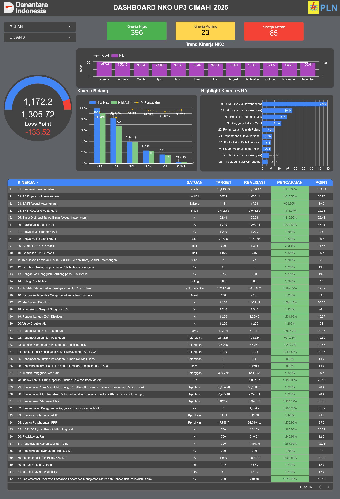
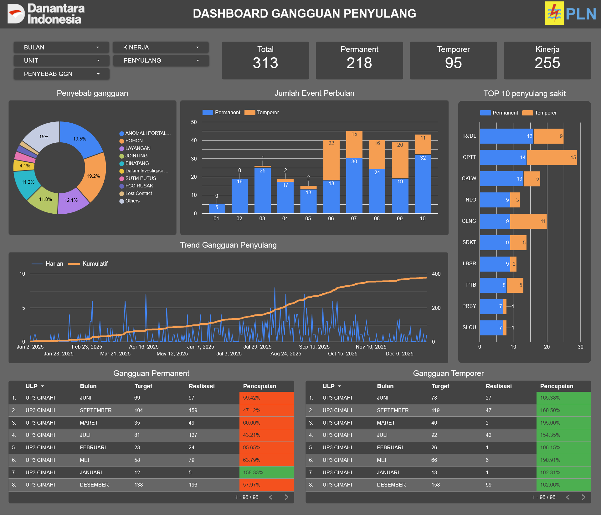
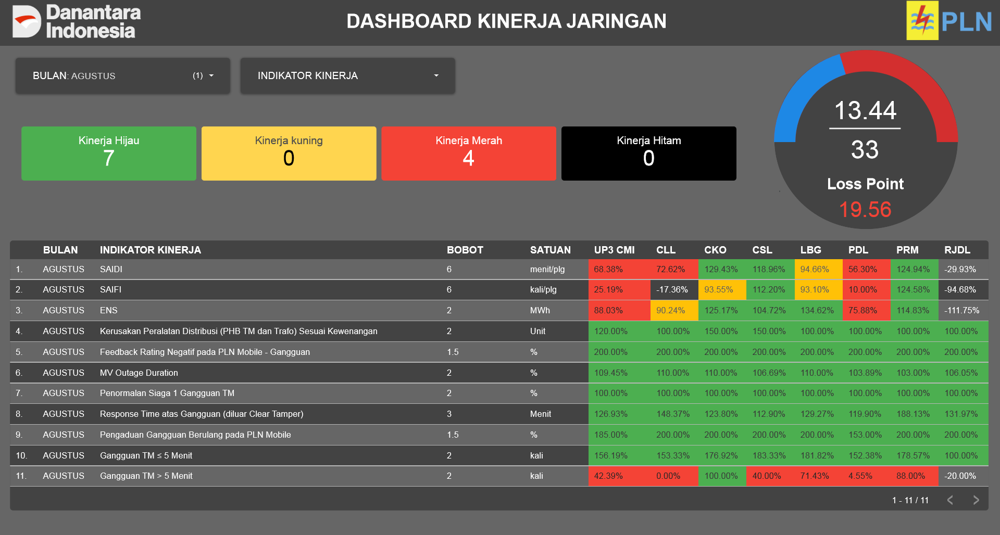
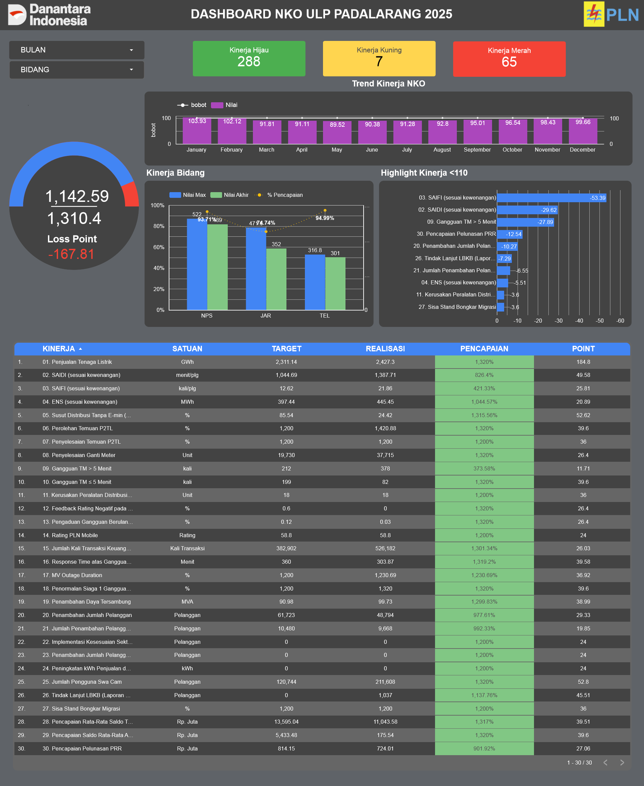

# ⚡ PT PLN (Persero) UP3 Cimahi — Dashboard Monitoring Kinerja Organisasi (NKO) & Operasional Jaringan

Proyek ini merupakan perancangan dan implementasi sistem Business Intelligence berbasis **Google Looker Studio** dan database terpusat **Google Sheets** untuk memonitor capaian **Nilai Kinerja Organisasi (NKO)** serta keandalan operasional jaringan listrik di seluruh wilayah kerja **PT PLN (Persero) UP3 Cimahi** (mencakup Kota Cimahi dan Kabupaten Bandung Barat).

---

## 🖥️ Tampilan Dasbor Utama (Executive Overview)

Dasbor eksekutif yang merangkum kesehatan kinerja organisasi UP3 Cimahi secara menyeluruh dengan indikator warna otomatis (*traffic light*):

> 🔗 **[Buka Dasbor Interaktif di Google Looker Studio](https://datastudio.google.com/reporting/744c4bea-9c47-44fc-a30f-f2afec72ebde/page/AFOVF)**  
> 📑 **[Lihat Dokumen Laporan Lengkap (PDF)](assets/pln_nko_complete_dashboard_report_2025.pdf)**

---

## 🎯 Dampak Nyata Proyek bagi PT PLN UP3 Cimahi

Implementasi dasbor ini memberikan dampak nyata langsung terhadap operasional dan pengambilan keputusan manajemen:

1. **⏱️ Efisiensi Waktu Pelaporan Hingga 80%**
   - Menggantikan proses konsolidasi manual data spreadsheet antar 7 Unit Layanan Pelanggan (ULP) yang sebelumnya memakan waktu berhari-hari setiap akhir bulan menjadi otomatis dan terpusat dalam satu dasbor real-time.

2. **🎯 Deteksi Cepat Titik Kritis & Unit Defisit**
   - Memudahkan manajemen mengidentifikasi unit dengan penurunan skor kinerja terbesar (seperti ULP Rajamandala dan ULP Padalarang) serta jalur penyulang dengan frekuensi padam tertinggi (*trip* terbanyak).
   - Penempatan tim teknis lapangan dan alokasi anggaran pemeliharaan jaringan menjadi jauh lebih terarah dan tepat sasaran.

3. **📊 Pengambilan Keputusan Berbasis Data (Data-Driven)**
   - Menyediakan *single source of truth* bagi jajaran manajemen dan asisten manajer dalam rapat evaluasi operasional bulanan/tahunan.
   - Evaluasi kesenjangan target (*gap analysis*) dapat dilakukan secara transparan per bidang fungsional (Pelayanan Pelanggan, Jaringan Distribusi, Transaksi Energi Listrik, Perencanaan, dan Keuangan).

---

## 🛠️ Apa yang Dikerjakan

Lingkup pekerjaan mencakup proses end-to-end dari pengolahan data mentah hingga penyajian analitik visual:

### 1. Integrasi & Pembersihan Data Terpusat (Data Preparation)
* Mengonsolidasikan data operasional dan capaian target dari **7 Unit Layanan Pelanggan (ULP)**: Cimahi Kota, Cibabat, Cimahi Selatan, Lembang, Cililin, Padalarang, dan Rajamandala.
* Membersihkan dan menyelaraskan format metrik teknis (durasi padam `menit/pelanggan` untuk SAIDI, frekuensi padam `kali/pelanggan` untuk SAIFI, penjualan energi `GWh/MWh`, dan poin skor NKO).

### 2. Pembangunan Sistem Pemantauan Otomatis (Traffic Light System)
* Merancang logika visual di Google Looker Studio untuk mengklasifikasikan performa secara otomatis:
  - 🟢 **Hijau**: Target tercapai ($\ge 100\%$)
  - 🟡 **Kuning**: Perlu perhatian khusus ($90\% - 99.9\%$)
  - 🔴 **Merah**: Kinerja kritis di bawah target ($< 90\%$)

### 3. Monitoring Keandalan Jaringan Distribusi (SAIDI, SAIFI, & Penyulang)
* Mengelompokkan dan memvisualisasikan data gangguan jaringan tegangan menengah (SUTM 20kV) menjadi kategori gangguan permanen dan temporer.
* Memetakan rekapitulasi gangguan pada masing-masing penyulang untuk mengidentifikasi jalur yang paling rentan padam.

---

## 📸 Tangkapan Layar Dasbor Operasional

### 1. Dasbor Rekapitulasi Gangguan Penyulang (Keandalan Jaringan)
Memantau frekuensi gangguan listrik, durasi padam, dan performa keandalan penyulang di seluruh wilayah kerja UP3 Cimahi:

---

### 2. Dasbor Monitoring Kinerja Unit Layanan Pelanggan (ULP)
Memantau pencapaian KPI masing-masing unit layanan pelanggan secara spesifik dan terperinci:

| 🏆 ULP Cibabat (Capaian NKO Tertinggi) | ULP Cimahi Kota |
| :---: | :---: |
|  |  |

---

## 🧰 Teknologi yang Digunakan

* **Visualisasi & BI:** Google Looker Studio
* **Penyimpanan Data & ETL:** Google Sheets (Relational Formulas, Data Validation)
* **Domain Metrik Kelistrikan:** SAIDI (System Average Interruption Duration Index), SAIFI (System Average Interruption Frequency Index), NKO (Nilai Kinerja Organisasi)

---

*Disusun oleh Rifasa Hadiarto • Proyek Portofolio Data & Business Intelligence Analyst*
