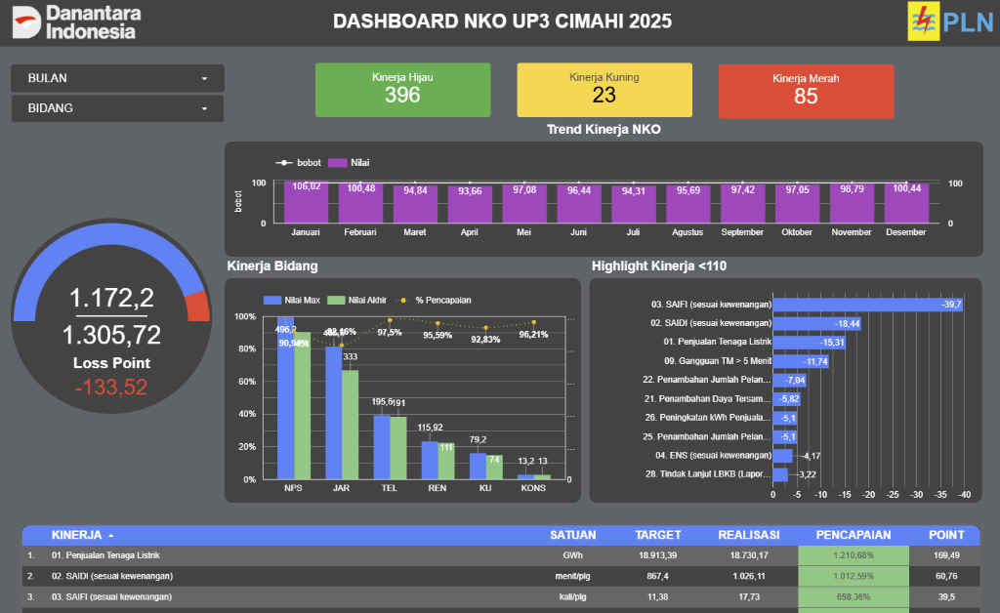

# ⚡ PT PLN (Persero) UP3 Cimahi — Nilai Kinerja Organisasi (NKO) & Grid Operations Monitoring Dashboard


---

## 🖥️ Live Executive Dashboard

> 🔗 **[Buka Dashboard Interaktif di Google Looker Studio](https://datastudio.google.com/reporting/744c4bea-9c47-44fc-a30f-f2afec72ebde/page/AFOVF)**



---

## 📌 Executive Summary

Proyek ini adalah perancangan **Executive Operations & Key Performance Indicator (KPI) Dashboard** untuk **PT PLN (Persero) UP3 Cimahi**. 

Dasbor ini mengintegrasikan seluruh indikator **Nilai Kinerja Organisasi (NKO)** lintas divisi—mulai dari keandalan jaringan kelistrikan, penjualan energi, hingga performa keuangan—ke dalam sistem visual berbasis *traffic light* (Hijau, Kuning, Merah) untuk mendukung pemantauan dan pengambilan keputusan strategis manajemen secara *real-time*.

---

## 🎯 Indikator Kinerja Utama (Core Metrics)

Dasbor ini memantau performa agregat tahunan dengan target capaian **1.305,72 poin**, dengan realisasi saat ini mencapai **1.172,20 poin** (*Loss Point: -133,52*):

```
+---------------------------------------------------------------------------------+
|                       STATUS KINERJA ORGANISASI (TRAFFIC LIGHT)                |
+--------------------------+-----------------------------+------------------------+
| 🟢 Kinerja Hijau: 396    | 🟡 Kinerja Kuning: 23       | 🔴 Kinerja Merah: 85   |
| (Target Tercapai)        | (Perlu Perhatian)           | (Defisit Kritis)       |
+--------------------------+-----------------------------+------------------------+
```

### 1. Keandalan Jaringan Kelistrikan (*Reliability Indices*)
* **SAIDI (*System Average Interruption Duration Index*):** Mengukur durasi rata-rata pemadaman yang dialami pelanggan (menit/pelanggan). Menjadi salah satu penyumbang defisit poin utama (-18,44 poin).
* **SAIFI (*System Average Interruption Frequency Index*):** Mengukur frekuensi rata-rata terjadinya pemadaman (kali/pelanggan). Penyumbang defisit poin terbesar (-39,70 poin).
* **Gangguan Tegangan Menengah (TM) > 5 Menit:** Menyumbang defisit -11,74 poin.
* **ENS (*Energy Not Served*):** Volume energi listrik yang tidak tersalurkan ke pelanggan akibat gangguan jaringan (-4,17 poin).

### 2. Komersial & Penjualan Tenaga Listrik
* **Penjualan Tenaga Listrik (GWh):** Target tahunan 18.913,39 GWh dengan realisasi 18.730,17 GWh (-15,31 poin defisit).
* **Pertumbuhan Pelanggan & Daya:** Melacak penambahan pelanggan baru dan penambahan daya tersambung (kVA).

### 3. Kinerja Lintas Bidang Operasional
Dasbor mengevaluasi rasio capaian kinerja per divisi kerja PLN UP3 Cimahi:
* **NPS (*Net Promoter Score*):** 90,94% pencapaian
* **JAR (*Jaringan*):** 88,16% pencapaian
* **TEL (*Transaksi Energi Listrik*):** 97,50% pencapaian
* **REN (*Perencanaan*):** 95,59% pencapaian
* **KU (*Keuangan & Umum*):** 92,83% pencapaian
* **KONS (*Konstruksi*):** 96,21% pencapaian

---

## 🔍 Temuan Kunci & Analisis Defisit (Root Cause Analysis)

1. **Titik Lemah Terbesar Ada pada Keandalan Jaringan (SAIFI & SAIDI):**  
   Defisit terbesar dari target NKO disumbangkan oleh indeks **SAIFI (-39,7 poin)** dan **SAIDI (-18,44 poin)**. Ini menunjukkan bahwa meskipun divisi Transaksi Energi (TEL) dan Konstruksi (KONS) berkinerja tinggi (>96%), keandalan frekuensi pemadaman masih menjadi penghambat utama pencapaian NKO maksimal.
2. **Volatilitas Tren Bulanan:**  
   Pencapaian bulanan NKO sempat berada di zona prima pada Januari (106,02) dan Februari (100,48), namun mengalami penurunan performa di kuartal 2 (Maret–Juli dengan titik terendah 93,66 pada April), sebelum kembali rebound ke angka 100,44 pada Desember.

---

## 💡 Rekomendasi Tindakan Strategis untuk Manajemen

1. **Fokus Preventif Pemeliharaan Jaringan (Divisi JAR):**  
   Memprioritaskan pemeliharaan rutin Saluran Udara Tegangan Menengah (SUTM) dan perabasan pohon di zona rawan untuk menekan angka SAIFI (frekuensi trip pemadaman).
2. **Percepatan Response Time Pemulihan (Recovery):**  
   Implementasi tim respons cepat dan manuver beban otomatis untuk menekan angka durasi padam (SAIDI) di bawah ambang batas kritis.
3. **Peluang Akuisisi Pelanggan Industri / Tambah Daya:**  
   Divisi Komersial/TEL disarankan mendorong kampanye promo tambah daya dan elektrifikasi agrikultur/industri untuk menutup gap penjualan tenaga listrik sebesar ~183 GWh.

---

## 🛠️ Arsitektur & Teknologi

* **Business Intelligence Tool:** Google Looker Studio
* **Data Source & Transformation:** Google Sheets ETL & Reporting Automation
* **Visual Components:**
  * Radial Gauge Chart (Loss Point & Target Progress)
  * Multi-Metric Scorecards dengan Conditional Traffic Light Formatting
  * Dual-Axis Line & Bar Combo Chart (Tren Bulanan & Kinerja Bidang)
  * Negative-Value Horizontal Bar Chart (Highlight Defisit Poin)
  * Interactive Interactive Drill-down Table & Slicers (Filter Bulan & Bidang)

---

## 👤 Author & Profil Analis

* **Nama:** Rifasa Hadiarto
* **Sertifikasi:** Certified Data Analyst — Badan Nasional Sertifikasi Profesi (BNSP)
* **Keahlian:** Business Intelligence, Operational Dashboards (Looker Studio & Tableau), Data Cleaning (Python/SQL), Process Automation (n8n).
